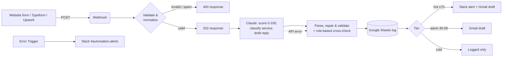

# AI Lead Intake & Qualification (n8n + Claude)

> Every inbound lead is validated, scored by AI, logged to Google Sheets, and routed —
> hot leads ping Slack with a ready-to-send Gmail reply draft within seconds.

    

<!-- Replace with your own recording: docs/demo.gif or a Loom link -->
**Demo:** _Loom walkthrough (3 min) — add link here_

---

## The problem

Small agencies and B2B teams answer leads in the order they arrive, not the
order that matters. A $30k enquiry waits behind three spam messages and a
student asking for free help. Response time drops, and the best leads go to
whoever replied first.

## The solution

An n8n workflow that runs on every form submission:



### What makes it production-grade (not a demo zap)

| Concern | How it is handled |
|---|---|
| **AI returns broken JSON** | `parseAi.js` strips code fences, extracts JSON from prose and repairs truncated output |
| **AI API is down / times out** | 3 retries with backoff, then a deterministic **rule-based score** is used so no lead is lost |
| **AI is confidently wrong** | AI score is stored next to the rules score; a gap ≥ 40 points sets `needs_review = TRUE` |
| **Spam & junk** | Honeypot field, email validation, low-intent keyword penalties (link-building, homework) |
| **Untestable Code nodes** | Logic lives in `src/`, is unit-tested, and `npm run build` injects it into the workflow JSON. CI fails if the JSON is out of date |
| **Silent failures** | Dedicated error workflow posts the failing node and error to Slack |
| **No auto-sending** | Replies are created as Gmail **drafts** — a human always clicks send |
| **Prompt changes** | Prompt is versioned in `prompts/` and reviewed like code |

## Results on the sample data

Running the 8 leads in `data/sample-leads.json` through the rule-based scorer:

| Lead | Rules score | Tier |
|---|---|---|
| Head of Ops, 400 invoices/month, budget approved | 96 | 🔥 hot |
| VP Growth, Indonesia market entry, 50k+ | 95 | 🔥 hot |
| Founder, Power BI retention dashboard | 79 | 🔥 hot |
| Senior Data Manager, cohort analysis | 68 | warm |
| Shopify owner, WhatsApp notifications | 62 | warm |
| Marketing manager, gmail, "not urgent, just exploring" | 24 | cold |
| Student asking for free homework help | 0 | cold |
| SEO backlink spam | 0 | cold |

Run `npm test` to reproduce. (Claude's scores add nuance on top; the rules are the safety net.)

## Tech stack

n8n (self-hosted via Docker) · Claude API (Messages API, Haiku-class model) ·
Google Sheets · Gmail · Slack · Node.js `node:test` · GitHub Actions

## Run it yourself

```bash
git clone https://github.com/YOUR_USERNAME/ai-lead-automation.git
cd ai-lead-automation
npm test                     # 9 unit tests, no dependencies needed
cp .env.example .env         # fill in values
docker compose up -d         # n8n on http://localhost:5678
```

Both workflow files were verified to import cleanly with the n8n CLI
(`n8n import:workflow`, n8n 2.45). Then follow **[docs/setup.md](docs/setup.md)** to add credentials, import
`workflows/*.json`, and fire the sample leads with `npm run send-test-leads`.

## Project structure

```
├── workflows/
│   ├── lead-intake-ai.json     # main workflow (generated — do not hand-edit)
│   └── error-handler.json      # Slack alert on any failure
├── src/                        # logic embedded into n8n Code nodes
│   ├── normalize.js            # validation, normalization, honeypot
│   ├── scoring.js              # deterministic fallback scorer
│   └── parseAi.js              # JSON extraction, repair, clamping
├── prompts/lead-qualification.md
├── scripts/
│   ├── build-workflow.mjs      # src/ + prompt → workflow JSON
│   └── send-test-leads.mjs     # fires sample leads at the webhook
├── data/sample-leads.json
├── test/lead.test.js
└── docs/setup.md
```

## Adapting it for a client

- **Different CRM:** swap the Google Sheets node for HubSpot / Pipedrive / Airtable — the item shape stays the same.
- **Different services:** edit the rubric in `prompts/lead-qualification.md` and `VALID_SERVICES` in `src/parseAi.js`.
- **WhatsApp instead of Slack:** replace the Slack node with the WhatsApp Business Cloud node.
- **Enrichment:** add a Clearbit/Apollo lookup between *Validate* and *Claude* to give the model company data.

## License

MIT — see [LICENSE](LICENSE).

---

Built by **Nuzul Nur Robbulizzat** · AI automation & business analytics ·
[LinkedIn](https://linkedin.com/in/nuzulnurri)
